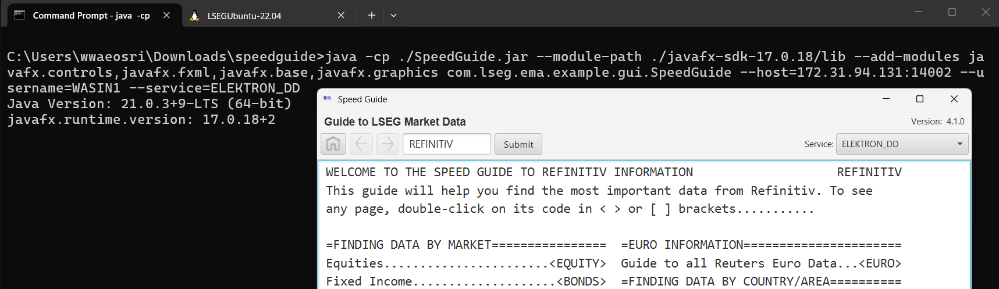
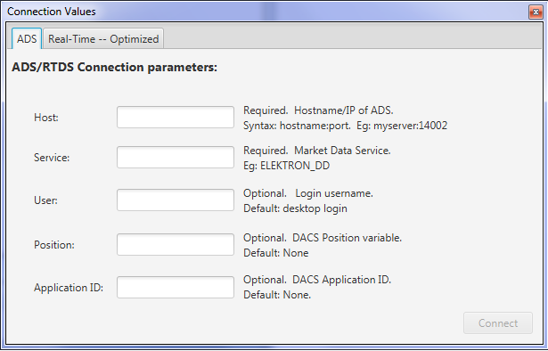
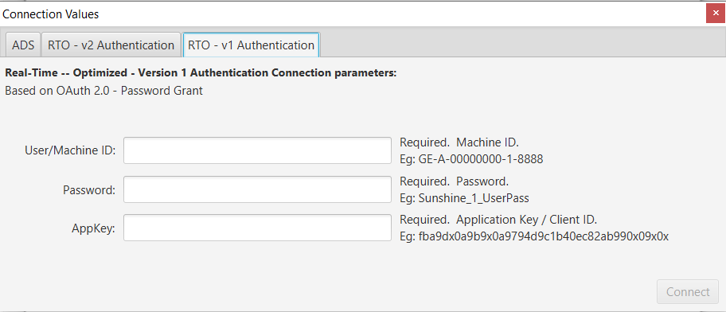
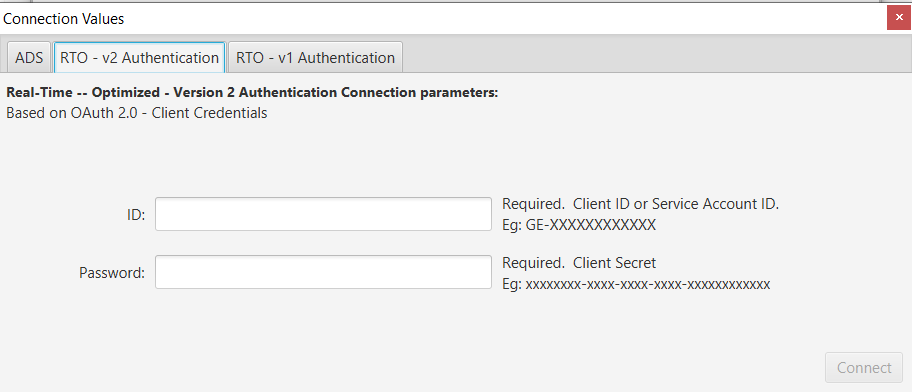
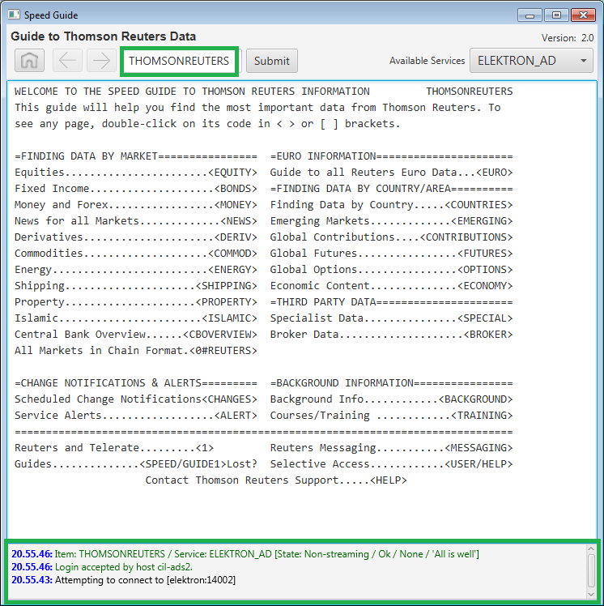
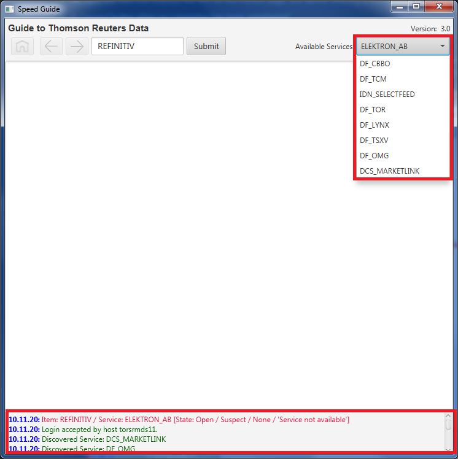
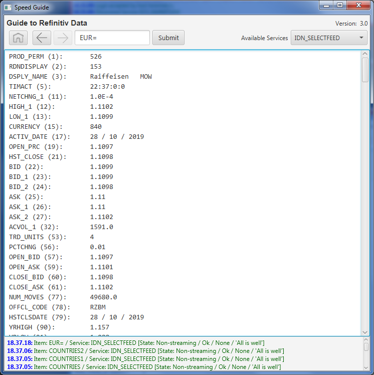
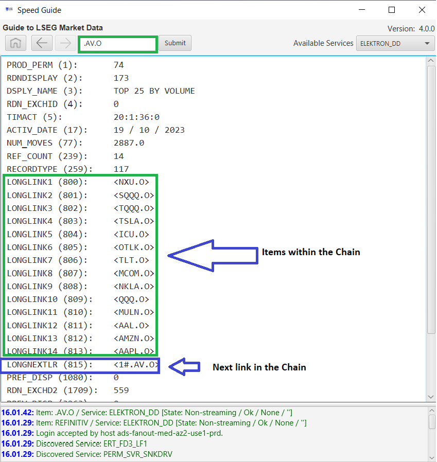

# Speed Guide

The Speed Guide utility allows users and developers, who do not have access to **LSEG Workspace** desktop applications, a simple and quick way to easily browse market data content available within LSEG Real-Time Platform.  The following guide outlines the fundamental purpose of speed guides and provides basic instructions to use the utility.  In addition, outlines the components and basic instructions to build the tool using the source code available within this project.

#### Important Note

**This Speed Guide tool is intended solely for demonstration and data exploration purposes and must not be deployed in any production environment. It is provided "AS IS," without warranty of any kind, express or implied, including but not limited to warranties of merchantability, fitness for a particular purpose, or non-infringement. No service level agreement (SLA), product support, or maintenance obligations are provided or implied.** 

**If you have any questions regarding how to use the tool, do not contact the Support team but please post the question on the Developer Portal [Q&A forum](https://community.developers.lseg.com/) page.**

## Overview

The Speed Guide utility allows users and developers who do not have access to the desktop application to browse market data content available from LSEG Real-Time Platform.  The utility provides access to either  cloud-based, Real-Time -- Optimized services or directly to your deployed Real-Time servers.

When building applications consuming streaming market data, developers often need a list of RICs (Instrument Codes), and the values they contain, for certain market, exchange, or instrument types.  The list of fields provided for these instrument types will differ depending on the type of asset.  To aid in the discovery and understanding of these assets, the Speed Guide utility is a graphical tool presenting data screen displays.  These data screens, or ***speed guides***, help users navigate through the universe of RICs and list the fields available for the specific asset.  Developers will be presented with a simple organization of the data to gain a better understanding which includes complex structures such as Option Chains, Indices, Futures, etc.

The Speed Guide tool registers for Snapshot only data content (i.e, non-streaming).

## Prerequisites For Building the Application Code

Required software components:

* [Real-Time SDK - Java edition](https://developers.lseg.com/en/api-catalog/real-time-opnsrc/rt-sdk-java) - LSEG Enterprise Message API to streaming, real-time services. It is declared as a Maven dependency (`com.refinitiv.ema:ema`) in [pom.xml](pom.xml), and Maven downloads it at build time; the version is set by the `rtsdk.version` property.
* Supported Java SDKs - Required to build and run the application. Please check supported SDK versions from the [API Compatibility Matrix](https://developers.lseg.com/en/api-catalog/real-time-opnsrc/rt-sdk-java/documentation#api-compatibility-matrix) page.
* [JavaFX library](https://openjfx.io/) - Used for the UI components. Maven downloads it at build time and bundles it into the application JAR files, so you do not need to install a JavaFX SDK to run the tool.
  Note: Java FX has been removed from the Java SDK by oracle since April 15, 2025 (Java 8 update 451). 
* [VScode](https://code.visualstudio.com/Download) - Visual Studio Code

### RTSDK and JavaFX Setup For Building Application

To build the application, set the Real-Time SDK (RTSDK) version and the JavaFX version in the `<properties>` section of the [pom.xml](pom.xml):

```xml
<properties>
  ...
  <javafx.version>17.0.18</javafx.version>
  <rtsdk.version>3.10.1.0</rtsdk.version>
</properties>
```

* `rtsdk.version`: the version of the Real-Time SDK - Java edition (`com.refinitiv.ema` dependency) to build against.
* `javafx.version`: the JavaFX version bundled into the application JAR files. **It must support the Java version used to run the application** (for example, JavaFX 17 requires Java 11 or later, JavaFX 21 requires Java 17 or later). See the [JDK and JavaFX compatibility information](https://gluonhq.com/products/javafx/).

You can also override either value from the command line without editing the `pom.xml` (see [Building and running](#building-and-running)).

## Utility download

The executable jar file and Readme is available for Download within the [LSEG Developer Platform](https://developers.lseg.com/en/tools-catalog/speedguide).

## Running the Utility

The Speed Guide utility provides the ability to connect directly to the Real-Time -- Optimized (RTO) or access through your deployed Real-Time streaming server (ADS) available within the RTDS (Real-Time Distribution System).

The package includes two executable JAR files with JavaFX bundled:

* **SpeedGuide-win.jar** for Windows (x64)
* **SpeedGuide-linux.jar** for Linux (x86_64)

**Note**: The project uses Java 11 as its baseline (`maven.compiler.source` and `maven.compiler.target` in `pom.xml`). Clients can build it with any Java SDK version supported by the selected Real-Time SDK and JavaFX versions; by default, Maven produces Java 11-compatible bytecode. The default bundled JavaFX 17 runs on Java 11 or later.

On Linux, JavaFX requires a desktop environment with the GTK 3 libraries installed (for example, the `libgtk-3-0` package).

### Launching the tool from the console

No JavaFX SDK installation or `--module-path` option is required. At the console, you can pass command-line parameters to the utility:

* #### Launching the executable JAR

  Windows:

  \> **java -jar ".\SpeedGuide-win.jar" [connection parameters]** 

  Linux:

  \> **java -jar ./SpeedGuide-linux.jar [connection parameters]**

  Or

  \> **java -cp ./SpeedGuide-linux.jar com.lseg.ema.example.gui.SpeedGuideLauncher [connection parameters]**

  JavaFX prints the warning `Unsupported JavaFX configuration: classes were loaded from 'unnamed module'` at startup. It is expected for a bundled JAR and can be ignored.
  
  When launching the executable JAR, users optionally specify command-line options and have the opportunity to see the output on the console.

  See examples below.

  

  
#### Command-line Options

    --service=serviceName   Optional. Service Name providing market data content.
                            Eg: ELEKTRON_DD. Default: Determined from Directory response.

    ************* ADS Connection Parameters **************
    --host=hostname:port    Required. ADS Server address/hostname and port of your Market Data
                            server. Syntax: <host/ip>:<port>.  Eg: elektron:14002 or 192.168.1.1:14002
    --user=userName         Optional. DACS User name required if authentication is enabled on server.
                            Note: if no user name is provided, the utility will use your desktop login
    --appid=ApplicationId   Optional. DACS Application ID if authentication is enabled on server.
                            Application ID has no default.
    --position=Position     Optional. DACS Position if authentication is enabled on server.
                            Position has no default.
        
    ************* Real-Time -- Optimized Connection Parameters **************
    --region=location       Optional. Specify the location to connect within the cloud.
	                          Eg: ap-northeast-1 (Asia) eu-west-1 (EU) us-east-2 (US). Default: us-east-1

    **** Version 1 Authentication >
    --machineId=machine ID  Required. Real-Time -- Optimized Machine ID/User required for OAuth Password Grant.
                            Eg: GE-A-00000000-1-8888
    --password=password     Required. Real-Time -- OPtimized password required for OAuth Password Grant.
                            Eg: Sunshine_1_UserPass
    --appKey=App Key        Required. Real-Time -- Optimized AppKey or Client ID required for server authentication.
                            Eg: x888x8x88888888x88888x88x8888xx88x88888x

    **** Version 2 Authentication >
    --clientId=Client ID    Required. Real-Time -- Optimized Client/Service Account ID required for OAuth Client Credentials.
                            Eg: GE-XXXXXXXXXXXX
    --clientSecret=secret   Required. Real-Time -- Optimized Client secret required for OAuth Client Credentials.
                            Eg: xxxxxxxx-xxxx-xxxx-xxxx-xxxxxxxxxxxx

    --keyStore=keystorefile Optional. A Java KeyStore (JKS) file to use for secure package exchange.
                            Default: none. The default Java cacerts keystore is used.
    --keyStorePasswd=passwd Optional. Password associated with the specified keystore file.
                            Default: none.

         
    --d[ebug]               Debug Mode.  Display verbose messages to the console
    --h[elp]                Prints this screen

The following example shows the command-line parameters to connect to either an ADS or directly to Real-Time -- Optimized in the cloud.

* java -jar ".\SpeedGuide-win.jar" --host=MY_ADS:14002 --user=USER1 --service=ELEKTRON_DD
* java -cp ./SpeedGuide-linux.jar com.lseg.ema.example.gui.SpeedGuideLauncher --clientId=GE-XXXX1234XXXX --clientSecret=9x999999-9xxx-9999-9x99-9x9xx99x9x99 --region=ap-northeast-1
* java -jar ./SpeedGuide-linux.jar --host=myserver:14002 --service=ELEKTRON_AD --user=testuser --appid=256 --position=127.0.0.1
* java -jar ".\SpeedGuide-win.jar" --clientId=GE-XXXX1234XXXX --clientSecret=9x999999-9xxx-9999-9x99-9x9xx99x9x99
* java -jar ".\SpeedGuide-win.jar" --clientId=GE-123X9ABCDE9Z --clientSecret=9z123456-9abc-5555-9a12-1a2bc34d5e67 --region=eu-west-1

## Usage

When launching the utility specifying insufficient command-line options, the user will be presented with a Connection dialog.  The user can choose how they want to access the platform, i.e. through their deployed real-time services, via ADS:



Or directly to the cloud via Real-Time -- Optimized (Version 1 authentication):



Or directly to the cloud via Real-Time -- Optimized (Version 2 authentication):



The _Status Pane_ at the bottom of the main window provides some general feedback, whether success or failure.  In the case where a successful connection can be made to your specified server, the utility will launch the root Speed Guide item, i.e. **REFINITIV**.

**Note**: While the utility will launch the "REFINITIV" RIC, which represents the root code of the Speed Guide pages, the utility is extremely useful for developers to visualize any other instrument available as well as optionally selecting an appropriate _Region_ when connecting to the cloud.



### Buttons

The _Home_ button takes the user back to this page at any time.

To navigate through the guide, double click on any text nested between **< >** characters.  Although suggested within the guides, this utility does not presently support NEWS codes nested between **[ ]** characters.

The top navigation menu provides:

* A _Home_ button to go back to the initial main page.
* A _Previous_ button to go back to the previous page (if it exists).
* A _Next_ button to go to next page (if it exists).
* An input text field that displays the RIC for the current page, and allows entering a RIC to request.
* A _Connect_ button when no connection has been established
* For cloud-based connections, the _RTO Region_ provides the opportunity to switch your region
* A _Service_ specification drop-down providing the list of services available within the connected server

During normal operation, or possibly at startup, the _Status Pane_ will highlight issues appropriately.  In the case where the user specifies an incorrect service, the _Service_ drop-down will give them the opportunity to select a valid one.



### Data Navigation

As you navigate through the guide, double-clicking on \<**_nested items_**\>, you may be presented with a simple fieldlist display of the IDs, or Field IDs (FIDs) for a given RIC.

For example:



Although not presented in a user-friendly display form, the native list of fields not only provides the user the ability to research all available fields for a given asset, but also the opportunity to better understand the structure of LSEG Data. 

#### Chains

Navigating through the guide, you will likely come across some more complex data structures.  For example, some market data elements, such as the Nasdaq Top 25, are represented as a collection of elements referred to as a **_Chain_**.  A _Chain_ contains a dynamically-sized collection of elements represented within a static list of underlying fields within a market data record.  In the case of the Nasdaq Top 25, there will be a total of 25 links.  Because a Chain is represented within a simple _MarketPrice_ structure containing a static number of links, the structure offers the ability to pull up the next link within this collection to allow applications to navigate through the chain to retrieve the desired collection.

To demonstrate, we manually entered the Nasdaq Top 25 index _.AV.O_:



We can see from above, the record contains a preset number of elements (1-14) and the ability to pull up the next group of elements within the _next link_.  For a detailed outline of Chains, refer to the article: [Simple Chain Objects](https://developers.lseg.com/article/simple-chain-objects-ema-part-1) within the Developer Community.

Feel free to navigate through the guide to discover many other assets and data elements offered by LSEG.

# Solution Code

The utility was developed using the [Real-Time SDK - Java](https://developers.lseg.com/en/api-catalog/real-time-opnsrc/rt-sdk-java) and Java's GUI library Java - JavaFx.


## Building and running

The Java FXML project is a Maven-based solution that generates a bundled distribution package using:

* `maven-shade-plugin` to build two executable JARs with dependencies, including JavaFX: `SpeedGuide-win.jar` (JavaFX `win` classifier) and `SpeedGuide-linux.jar` (JavaFX `linux` classifier).
* `maven-assembly-plugin` to zip both JARs and `README.txt` for distribution.

The JAR entry point is `com.lseg.ema.example.gui.SpeedGuideLauncher`, which does not extend `javafx.application.Application`; this is what allows JavaFX to start from the classpath without `--module-path`.  To bundle a different JavaFX version, override the `javafx.version` property:

Bash / Command Prompt:

```bash
mvn clean package -Djavafx.version=21.0.13
```

PowerShell:

```powershell
mvn clean package "-Djavafx.version=21.0.13"
```

**Note**: In PowerShell, wrap each `-D` property in double quotes. Without quotes, PowerShell splits the argument at the `.` and Maven fails with `Unknown lifecycle phase ".version=21.0.13"`.

Build the package using:

```bash
mvn clean package
```

After packaging, the generated `target/SpeedGuide.zip` contains `SpeedGuide-win.jar`, `SpeedGuide-linux.jar` and `README.txt`. The `target/SpeedGuide.jar` file is the thin project JAR without dependencies and is not distributed.

## Troubleshooting

**As I have mentioned above. This tool is provided "as" with no service level agreement (SLA). If you have any questions regarding how to use the tool, please post the question on the Developer Portal [Q&A forum](https://community.developers.lseg.com/) page.**

## Contributing

Please read [CONTRIBUTING.md](https://gist.github.com/PurpleBooth/b24679402957c63ec426) for details on our code of conduct, and the process for submitting pull requests to us.

## Authors

| **Name** | **Release** | **Details** |
| --- | --- | --- |
| Wasin Waeosri | Release 4.3.0 | Bundled JavaFX into OS-specific JARs (`SpeedGuide-win.jar`, `SpeedGuide-linux.jar`); no JavaFX SDK or `--module-path` needed |
| Wasin Waeosri | Release 4.2.2 | Updated the RTSDK, README, and Distribution package |
| Wasin Waeosri | Release 4.2.0 | Updated the built Java version to Java 11 (**As of Mar 2026**) |
|  |  | Updated RTSDK version to version 3.9.2 (**As of Mar 2026**) |
|  |  | Removed .exe built |
|  |  | Removed keystore requirement |
| Wasin Waeosri | Release 4.1.0 | Added JavaFX information when run jar file |
|  |  | Added JavaFX dependencies to pom.xml |
|  |  | Added information about Q&A forum and product non-SLA |
| Nick Zincone | Release 4.1.0 | Ability to specify region |
|  |  | Default service based on Directory interrogation |
| Nick Zincone | Release 4.0.0 | Added access to Real-Time -- Optimized v2 authentication. Rebranded (LSEG) |
| Nick Zincone | Release 3.2 | Fixed dictionary download issue; rebuilt using newly branded (Refinitiv) SDK |
| Nick Zincone | Release 3.1 | Fixed connectivity issues and re branded. |
| Nick Zincone | Release 3.0 | Added access to Real-Time -- Optimized, formally ERT in Cloud, streaming services. |
| Nick Zincone | Release 2.1 | Added DACS fields required for login to Elektron. |
| Nick Zincone | Release 2.0 | Additional error checking |
|  |  | Utilized JavaFX Scene Builder to generate FXML |
| Susana Chang | Release 1.1 | Initial implementation |

## License

This project is licensed under the MIT License - see the [LICENSE.md](LICENSE.md) file for details
